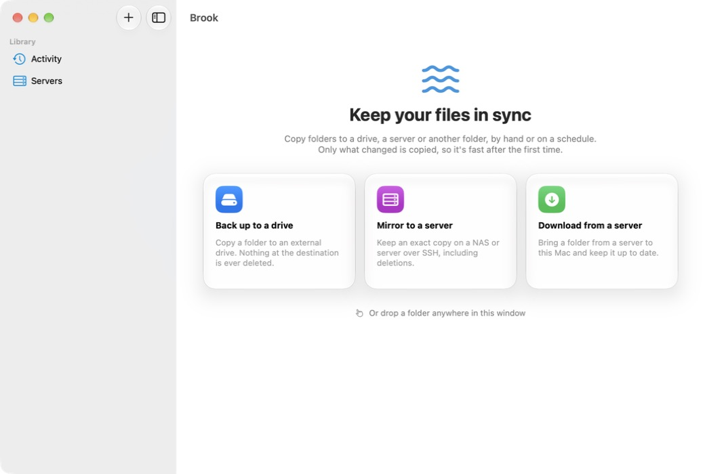

# Brook

A native macOS app for keeping folders in sync, built on [rsync](https://rsync.samba.org/).

Brook aims to be simple enough for anyone ("back up this folder to that drive") while giving power users full control over rsync.



> **Status:** early development. The core works, but expect rough edges and breaking changes.

## Features

- **Two plain-language modes.** *Copy new & changed* never deletes anything. *Mirror* makes the destination match the source exactly.
- **Preview before you sync.** See every file that would be added, updated or deleted, without changing anything.
- **Safety checks:**
  - Warns before a sync deletes a lot of files.
  - Refuses to run when an external drive isn't connected, instead of filling your startup disk.
  - Asks before mirroring an empty folder.
  - Requires a preview before the first mirror.
- **Local and remote.** Sync between folders on your Mac, external drives, or servers and NAS boxes over SSH. Hosts from `~/.ssh/config` can be imported.
- **Schedules.** Run syncs every few hours, daily, weekly or monthly. Brook catches up on runs missed while the Mac was asleep.
- **Menu bar companion.** See what's running and start syncs without opening the window.
- **Clear errors.** rsync and SSH failures are translated into readable messages with a suggested fix.
- **Power-user options:**
  - Include/exclude rules.
  - Bandwidth limits.
  - Checksums.
  - Backup folders.
  - Raw extra arguments.
  - Commands that run before and after each sync.
  - A live preview of the exact rsync command.
- **Bundled rsync 3.** macOS ships `openrsync`, which lacks features Brook relies on, so Brook includes a modern rsync. It can also use Homebrew's rsync or one you choose.

## Requirements

- macOS 26 or later
- Xcode 27 or later (to build)
- [XcodeGen](https://github.com/yonaskolb/XcodeGen): `brew install xcodegen`

## Building

```bash
git clone https://github.com/georgeyjm/brook.git
cd brook

# Optional: build the bundled rsync helper (universal binary, ~1 minute).
# If you skip this, Brook uses Homebrew's rsync when it's installed.
Vendor/rsync/build-rsync.sh

# Generate the Xcode project from project.yml, then open it.
xcodegen generate
open Brook.xcodeproj
```

In Xcode, choose the **Brook** scheme and **My Mac**, then press **⌘R**.

`Brook.xcodeproj` is generated from `project.yml` and isn't committed. Re-run `xcodegen generate` after adding or removing source files.

## Running the tests

The sync engine lives in a Swift package with its own tests:

```bash
cd Packages/SyncCore
swift test
```

The integration tests run a real rsync 3 against temporary folders. They use Homebrew's rsync by default; set `RSYNC_PATH` to test another binary, for example the bundled one:

```bash
RSYNC_PATH="$PWD/../../Vendor/rsync/out/rsync" swift test
```

## Project layout

| Path | What's there |
|---|---|
| `App/` | The SwiftUI app: windows, menu bar, settings, scheduling and notifications |
| `Packages/SyncCore/` | The engine, with no UI. Each module is listed below. |
| `Packages/SyncCore/…/SyncModel` | Data types (syncs, servers, schedules, run records) |
| `Packages/SyncCore/…/RsyncCore` | Builds rsync commands, runs rsync, parses its output, explains its errors |
| `Packages/SyncCore/…/SyncEngine` | Runs a preview or sync end to end, including safety checks and hooks |
| `Packages/SyncCore/…/SyncStore` | Saves syncs and run history as JSON |
| `Packages/SyncCore/…/SyncScheduler` | Schedule date maths |
| `Packages/SyncCore/…/SSHKit` | Reads `~/.ssh/config` |
| `Vendor/rsync/` | Script and pinned version for building the bundled rsync |
| `project.yml` | XcodeGen project definition |

## Where Brook keeps its data

Your syncs and run history live in `~/Library/Application Support/Brook/`:
- `syncs.json` holds your syncs and servers. It's human-readable, and a `.bak` copy of the previous version is kept.
- `History/` holds a record and a full rsync log for each run.

Quit Brook and delete that folder to start fresh.

## Credits

rsync is free software by Andrew Tridgell, Wayne Davison and others, released under the GNU General Public License v3. Brook runs it as a separate program. Its source is available from [rsync.samba.org](https://rsync.samba.org/), and `Vendor/rsync/build-rsync.sh` shows exactly how the bundled copy is built.
